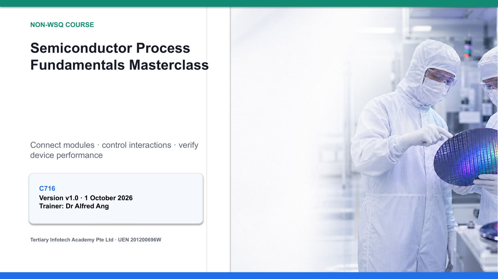

# Semiconductor Process Fundamentals Masterclass

A highly visual, two-day masterclass on CMOS process modules, cross-module integration, device and reliability performance, SPC, packaging and next-generation IC technologies.

| Course detail | Information |
|---|---|
| Course code | `C716` |
| Programme | Non-WSQ |
| Duration | 2 days · 15 hours (9:30am – 5:30pm) |
| Registration | [View course details and register](https://www.tertiarycourses.com.sg/semiconductor-process-fundamentals-masterclass.html) |
| Courseware version | v1.0 · 1 October 2026 |

## About the course

A wafer fab is a connected system, not a collection of tools: every module hands variation, defects and evidence to the next. This masterclass builds that integration mindset. Learners work through patterning, etch, implantation, thermal processing, film deposition and CMP, then connect them into an integrated FEOL-to-BEOL flow. They go on to verify integration with metrology, electrical data, yield models and reliability evidence, control excursions with SPC, and evaluate packaging, chiplets, FinFET and GAAFET technologies against capability and reliability gates.

The course suits process, equipment, integration, quality and yield engineers, technicians and technical managers in the semiconductor industry.

## Learning outcomes

- **LO1:** Identify process flows and modules for specific CMOS technologies in manufacturing.
- **LO2:** Determine CMOS device performance and verify process integration in accordance with product specifications.

## Topics covered

1. **Topic 1 — CMOS Process Modules and Process Flow**
   - *Learning Block 1A — Patterning, Etch and Fab Control:* the wafer fab as a system, contamination pathways, the lithography stack, resist processing, resolution and process margin, overlay and OPC, wet versus dry etch, selectivity and profile, strip and clean, the pattern-transfer window.
   - *Learning Block 1B — Implant, Thermal, Films and Integrated Flow:* implant dose and energy, crystal damage and activation, diffusion/furnace/RTP, thermal oxidation, CVD/PECVD/epitaxy, PVD barrier and seed, copper dual damascene, CMP and planarity failure modes, integrated FEOL/BEOL and cross-module budgeting.
2. **Topic 2 — CMOS Process Integration and Performance**
   - *Learning Block 2A — Integration Performance, Yield and Reliability:* isolation and well integration, transistor formation, yield and defect density, metrology strategy, electrical performance, HCI/TDDB/electromigration, control limits versus specifications, Cp and Cpk, evidence-based release.
   - *Learning Block 2B — SPC, Packaging and Future Integration:* SPC as a feedback system, variable and attribute control charts, excursion response, packaging flow, wire bond and flip chip, 2.5D/3D and chiplets, FinFET, GAAFET nanosheets and beyond-CMOS devices.

## Activities

Each activity folder holds a guide, worksheet, checklist and evidence template (Markdown + PDF), with Excel workbooks where the analysis needs one. See [activities/README.md](activities/README.md).

- [Activity 1 — Build a CMOS Process Module Map](activities/activity-01-process-module-map/README.md)
- [Activity 2 — Diagnose a Pattern-Transfer Process Window](activities/activity-02-pattern-transfer-window/README.md)
- [Activity 3 — Balance Implantation and Thermal Budget](activities/activity-03-implant-thermal-budget/README.md)
- [Activity 4 — Integrate Film Deposition and CMP](activities/activity-04-film-cmp-integration/README.md)
- [Activity 5 — Review an STI Integration Flow](activities/activity-05-sti-integration-review/README.md)
- [Activity 6 — Analyse Yield and Process Capability](activities/activity-06-yield-capability-analysis/README.md)
- [Activity 7 — Respond to an SPC CD Excursion](activities/activity-07-spc-cd-excursion/README.md)
- [Activity 8 — Run a Future-Technology Integration Gate](activities/activity-08-technology-integration-gate/README.md)

## Public package

- [Slide deck (PPTX)](<courseware/Semiconductor Process Fundamentals Masterclass (C716)-v1.0.pptx>) · [PDF](<courseware/Semiconductor Process Fundamentals Masterclass (C716)-v1.0.pdf>)
- [Lesson Plan (DOCX)](<courseware/LP-Semiconductor Process Fundamentals Masterclass (C716).docx>) · [PDF](<courseware/LP-Semiconductor Process Fundamentals Masterclass (C716).pdf>)
- [Learner Guide (DOCX)](<courseware/LG-Semiconductor Process Fundamentals Masterclass (C716).docx>) · [PDF](<courseware/LG-Semiconductor Process Fundamentals Masterclass (C716).pdf>) · [Markdown](<LG-Semiconductor Process Fundamentals Masterclass (C716).md>)
- [activities/](activities/) — the eight activity folders
- `tools/` — scripts used to build this courseware

Use only the fictional scenario data provided. Never upload confidential process, product or customer data.

## Distribution boundary

This public repository contains learner-facing courseware only. Source references, credentials and internal build inputs are excluded.

---

© Tertiary Infotech Academy Pte Ltd · UEN 201200696W · [www.tertiarycourses.com.sg](https://www.tertiarycourses.com.sg/)
